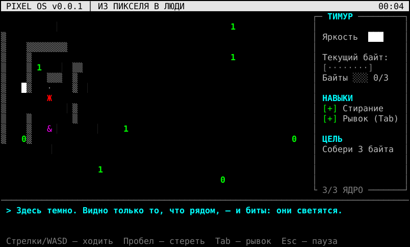
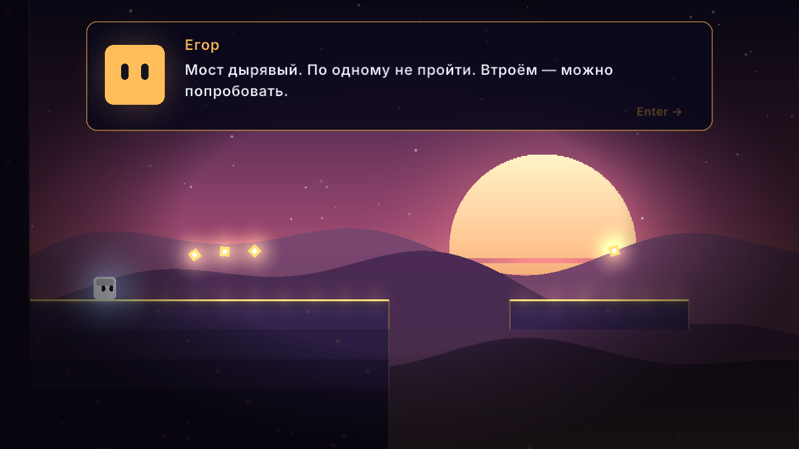
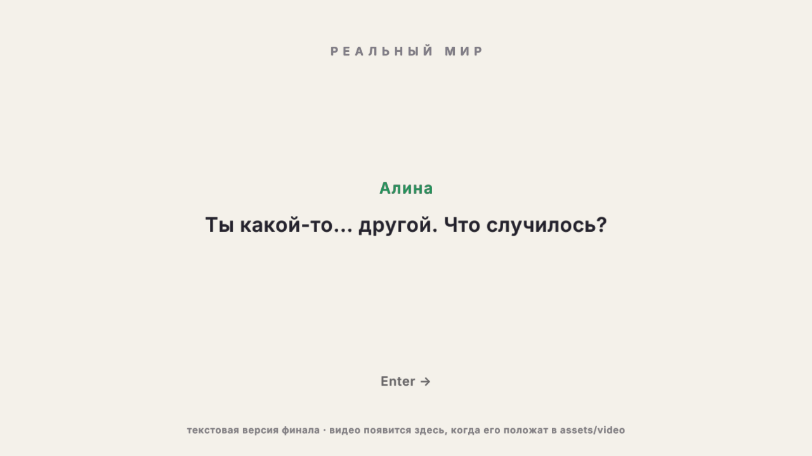
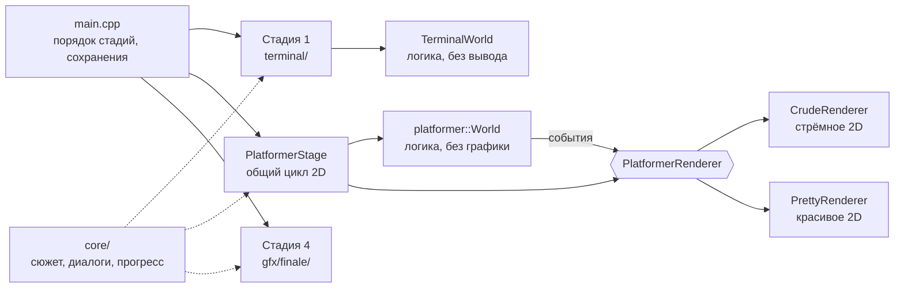

<div align="center">

# ИЗ ПИКСЕЛЯ В ЛЮДИ

**Сюжетная инди-игра на полчаса о мире, которому стало всё равно.**

Тимур просыпается пикселем в уничтоженном параллельном мире.
Чем больше он меняется, тем больше мир вспоминает себя — и тем лучше становится графика самой игры:
консоль → стрёмное 2D → красивое 2D → реальная жизнь.

[](https://github.com/SaTu-u/OurGame/actions/workflows/ci.yml)


</div>

---

## О чём игра

Вечером Тимур ответил друзьям «Мне всё равно, делайте сами» и уснул. Проснулся он не дома:
чёрная пустота, мигающий курсор — и чувство, что курсор теперь он сам.

Это **параллельный мир**, и он уничтожен. Его не взорвали и не захватили — в нём всем стало всё равно.
Тогда пришло **Обнуление**: оно стёрло цвета, потом формы, и от мира осталась одна командная строка.

Тимура ведут **Алина** и **Егор** этого мира — последние, кому не всё равно. Их собственный Тимур
когда-то сказал те же слова и исчез первым. Алина учит принимать помощь, Егор — не тянуть и отвечать
за других. С каждым шагом Тимура мир возвращает себе кусочек: форму, цвет, свет.

А в финале игра выходит из своего окна: запускается **настоящее видео**, где трое актёров играют
Тимура, Алину и Егора уже в реальном мире.

> Главная фишка: смена графики — это не декорация, а сюжет. Мир выглядит лучше, потому что герой стал лучше.

Полный сюжет — в [docs/STORY.md](docs/STORY.md), все реплики — в [assets/story.txt](assets/story.txt).

## Четыре стадии

| | Стадия | Что с миром | Что делает игрок | Чему учится Тимур |
|---|---|---|---|---|
| 1 | **Терминал** — 3 сектора | Осталась командная строка | Пиксель собирает биты, удирает от жуков и от Обнуления. В третьем секторе гаснет свет | «Потом» не работает: кто стоит на месте, того стирает |
| 2 | **Стрёмное 2D** — 4 уровня | Мир вспомнил форму. Криво: 320×180, палитра Paint, WordArt, глитчи | Платформер: прыжки, шипы, пружины. Алина даёт двойной прыжок | Просить о помощи и говорить «спасибо» |
| 3 | **Красивое 2D** — 4 уровня | Мир вспомнил цвет. Окно растёт до 1280×720, неон, частицы, свет | Тот же мир, но сложнее. Егор даёт рывок | Действовать сразу и помогать другим |
| 4 | **Реальность** | Здесь ещё ничего не стёрто | Видео с живыми актёрами и титры | Отвечает друзьям и приходит сам |

Прохождение занимает около **30 минут**: примерно треть — диалоги, остальное — игра.
По уровням спрятаны семь **осколков памяти** — записи о том, как погибал этот мир.

<table>
<tr>
<td width="50%"><br><sub>Стадия 1. Жёлтая волна — Обнуление. Кто стоит на месте, того стирает.</sub></td>
<td width="50%"><br><sub>Сектор 3. Света не осталось: видно только то, что рядом, и светящиеся биты.</sub></td>
</tr>
<tr>
<td width="50%"><br><sub>Стадия 2. Мир вспомнил форму, но драйвер восстановлен криво.</sub></td>
<td width="50%"><br><sub>Стадия 3. Тот же мир, но уже с цветом. Зелёный спутник — Алина.</sub></td>
</tr>
<tr>
<td width="50%"><br><sub>Алина и Егор идут рядом и говорят с Тимуром всю дорогу.</sub></td>
<td width="50%"><br><sub>Финал в реальном мире. Пока видео не снято, сцена показывается текстом.</sub></td>
</tr>
</table>

## Управление

| Действие | Терминал | 2D |
|---|---|---|
| Ходить | стрелки / WASD / ЦФЫВ | стрелки / A, D |
| Прыжок | — | Пробел / W / ↑ |
| Навык 1 | Пробел — стереть жуков вокруг | второй прыжок в воздухе (от Алины) |
| Навык 2 | Tab — рывок сквозь жуков | Shift — рывок (от Егора) |
| Диалоги | Enter | Enter / Пробел |
| Пауза | Esc | Esc |

Геймпад тоже работает (стик/крестовина, A — прыжок, X или RB — рывок).

## Как запустить

Нужны **CMake 3.20+** и компилятор с **C++20**. Библиотека raylib скачается сама при первой сборке.

### Windows

**Visual Studio 2022** — «Открыть локальную папку», выбрать папку проекта, дождаться CMake, выбрать цель
`pixel_to_people.exe` и запустить. Или **CLion** — просто открыть папку проекта.

Чтобы первая стадия шла в консоли, запусти собранный `pixel_to_people.exe` двойным щелчком
или из `cmd` / PowerShell / Windows Terminal (окно вывода IDE — не настоящий терминал,
в нём игра сразу перейдёт ко второй стадии).

Готовую сборку под Windows можно скачать во вкладке **Actions** → последний зелёный запуск → `pixel-to-people-windows`.

### Linux

```bash
sudo apt install cmake g++ libx11-dev libxrandr-dev libxinerama-dev libxcursor-dev libxi-dev libgl1-mesa-dev
```

```bash
cmake -S . -B build -DCMAKE_BUILD_TYPE=Release
```

```bash
cmake --build build -j
```

```bash
./build/pixel_to_people
```

### macOS

```bash
brew install cmake
```

Дальше — те же три команды, что для Linux.

### Параметры запуска (удобно для презентации)

```bash
./build/pixel_to_people --stage 3 --level 2 --demo
```

| Параметр | Что делает |
|---|---|
| `--stage N` | начать со стадии 1–4 (`terminal`, `crude`, `pretty`, `finale`) |
| `--level M` | вместе с `--stage`: начать с уровня (или сектора) M |
| `--demo` | режим показа: клавиша **N** пропускает уровень или сектор |
| `--new` | начать заново, игнорируя сохранение |
| `--no-video` | не открывать видео в финале |
| `--help` | справка |

Прогресс сохраняется автоматически в `save.txt` рядом с папкой `assets`.

## Тесты

Логика игры отделена от графики, поэтому её можно проверять автоматически — **60 тестов**:
физика, жуки, Обнуление, пружины, сюжетные точки, сохранения, разбор уровней и сюжета.

Есть и «бот-тестировщик»: он сам перебирает действия игрока и проверяет, что **каждый из восьми уровней
можно пройти**, что все осколки памяти достижимы и что без Алины и Егора нужные места не взять —
то есть друзья нужны не только по сюжету, но и по механике.

```bash
ctest --test-dir build --output-on-failure
```

GitHub Actions собирает игру на Linux и Windows и прогоняет тесты на каждый пуш.

## Как устроен код



Главная идея: **мир один, графика разная.** `World` ничего не рисует, а только сообщает о событиях
(«прыгнул», «раздавил жука», «нашёл осколок»). Стрёмное и красивое 2D — две реализации одного интерфейса
`PlatformerRenderer` (паттерн «Стратегия»). Подробно — в [docs/ARCHITECTURE.md](docs/ARCHITECTURE.md).

```
src/
├── core/         сюжет, диалоги, прогресс и сохранения, UTF-8, аргументы
├── terminal/     стадия 1: свой «движок» консоли (Windows + Linux/macOS), мир пикселя, секторы
├── platformer/   физика, уровни, жуки, пружины, друзья, сюжетные точки — без единой строчки графики
├── gfx/          всё, что рисует raylib: стрёмное 2D, красивое 2D, финал, синтез звуков
└── main.cpp
assets/
├── story.txt     весь сюжет — правится без пересборки
├── credits.txt   титры
├── levels/       3 карты терминала и 8 уровней, нарисованные символами
├── fonts/        шрифты с кириллицей
└── video/        сценарий финальной сцены и место для видео
tests/            юнит-тесты и бот-тестировщик
```

Что можно менять без программирования:

- **Сюжет и реплики** — [`assets/story.txt`](assets/story.txt)
- **Уровни** — [`assets/levels/*.txt`](assets/levels) (`#` блок, `^` шипы, `x` жук, `S` пружина, `!` разговор, `?` осколок памяти…)
- **Титры и имена команды** — [`assets/credits.txt`](assets/credits.txt)
- **Финальное видео** — снять по [сценарию](assets/video/final_cutscene.txt) и положить `finale.mp4` в [`assets/video/`](assets/video)

## Команда

| Участник | Роль в команде | Ветка | Зона ответственности |
|---|---|---|---|
| **Тимур «SaTu»** | тимлид, геймдизайн, сценарий | `stage1-terminal` | стадия 1, сюжет, `main.cpp`, презентация |
| **Участник 2** | программист движка | `stage2-crude` | физика и уровни, стадия 2 |
| **Участник 3** | графика и эффекты | `stage3-pretty` | стадия 3, финал, монтаж видео |

В финальном видео трое играют Тимура, Алину и Егора. Кто что сделал — видно по истории коммитов в каждой ветке.
Распределение задач, план до сдачи и правила работы с git — в [docs/TEAM.md](docs/TEAM.md).

## Документация

- [docs/STORY.md](docs/STORY.md) — сюжет целиком: мир, герои, чему учится Тимур
- [assets/video/final_cutscene.txt](assets/video/final_cutscene.txt) — сценарий финальной сцены для съёмки
- [docs/TEAM.md](docs/TEAM.md) — роли, ветки, план до 1 декабря
- [docs/ARCHITECTURE.md](docs/ARCHITECTURE.md) — как устроен код и почему
- [docs/PRESENTATION.md](docs/PRESENTATION.md) — план презентации и демо
- [CONTRIBUTING.md](CONTRIBUTING.md) — как добавить уровень, реплику или фичу

## Лицензия

Код — [MIT](LICENSE). Шрифты распространяются по своим лицензиям (см. [`assets/fonts`](assets/fonts)).
