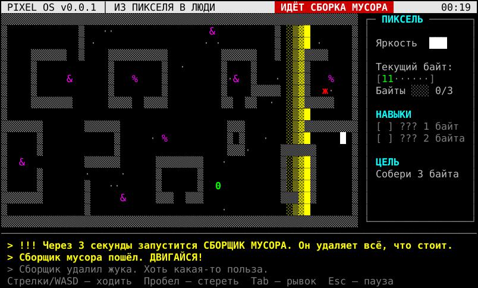
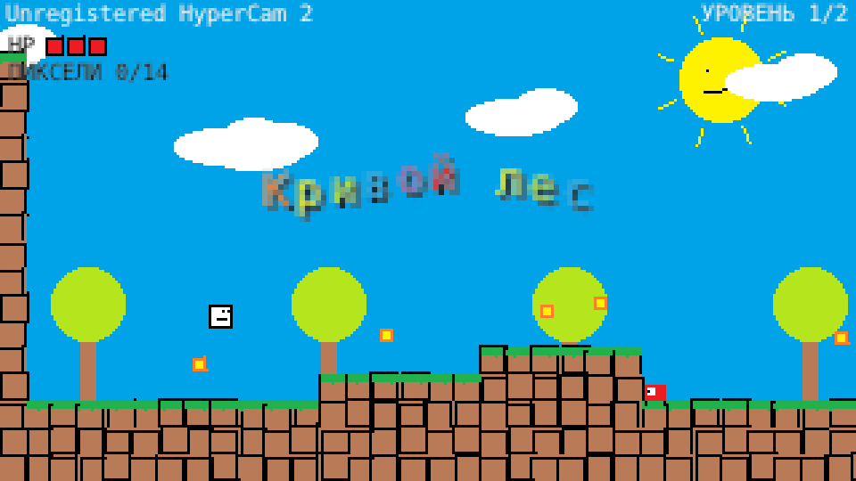
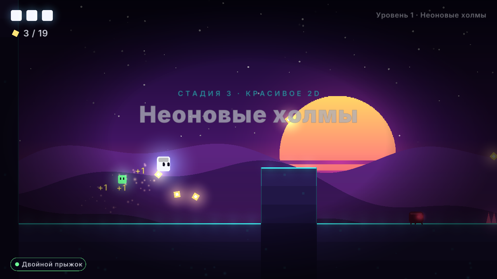
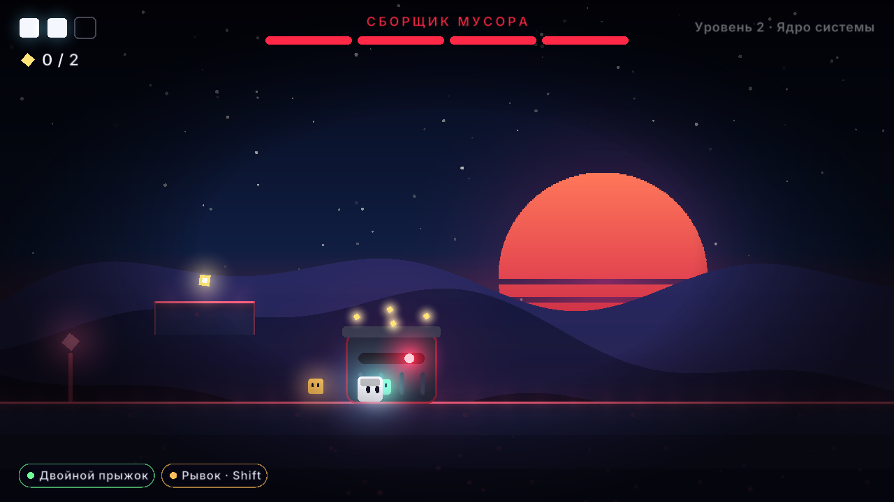
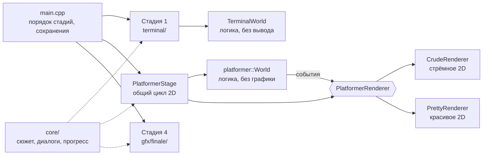

<div align="center">

# ИЗ ПИКСЕЛЯ В ЛЮДИ

**Инди-игра, которая эволюционирует вместе с героем.**

Ты — один пиксель в чёрном терминале. Чем сильнее ты становишься,
тем лучше становится сама игра: консоль → стрёмное 2D → красивое 2D → реальная жизнь.

[](https://github.com/SaTu-u/OurGame/actions/workflows/ci.yml)


</div>

---

## О чём игра

Однажды курсор в терминале мигнул не по расписанию — и понял, что мигает **сам**.
Так появился **Пиксель**. Мир, в котором он живёт, жесток: жуки-баги пожирают всё, что светится,
а **Сборщик Мусора** стирает всё, что «не используется».

Чтобы выжить, Пиксель собирает данные, встречает кентов — **Глюка** и **Шейдера** — и шаг за шагом
вырывается из консоли во всё более «дорогую» графику. А в финале игра буквально выходит из своего окна:
пиксели становятся людьми, и запускается **настоящее видео**, где команда играет героя и его друзей.

> Главная фишка: смена графики — это не декорация, а сюжет. Игра «прокачивается» вместе с героем.

## Четыре стадии

| | Стадия | Как выглядит | Что делаешь |
|---|---|---|---|
| 1 | **Терминал** | Запускается прямо в консоли. ASCII, загрузка выдуманной PIXEL OS | Пиксель-курсор собирает биты, удирает от жуков и от Сборщика Мусора. 8 бит = байт = новый навык |
| 2 | **Стрёмное 2D** | 320×180, палитра из Paint, обводки мимо, облака едут не туда, WordArt, глитчи | Платформер. Встреча с Глюком — двойной прыжок |
| 3 | **Красивое 2D** | Окно растёт до 1280×720. Неоновый закат, параллакс, частицы, свечение | Тот же мир, но красиво. Шейдер даёт рывок. Битва со Сборщиком Мусора |
| 4 | **Реальность** | Пиксели мельчают и исчезают | Открывается видео из реальной жизни, потом титры со статистикой |

<table>
<tr>
<td width="50%"><br><sub>Стадия 1. Терминал: жёлтая колонна — Сборщик Мусора. Кто стоит — того соберут.</sub></td>
<td width="50%"><br><sub>Стадия 2. Стрёмное 2D: видеодрайвер установлен криво.</sub></td>
</tr>
<tr>
<td width="50%"><br><sub>Стадия 3. Красивое 2D: тот же мир, но с неоном и частицами.</sub></td>
<td width="50%"><br><sub>Босс — Сборщик Мусора. Когда он оглушён, прыгай ему на голову.</sub></td>
</tr>
</table>

## Управление

| Действие | Терминал | 2D |
|---|---|---|
| Ходить | стрелки / WASD / ЦФЫВ | стрелки / A, D |
| Прыжок | — | Пробел / W / ↑ |
| Навык 1 | Пробел — Backspace (стереть жуков вокруг) | второй прыжок в воздухе |
| Навык 2 | Tab — рывок сквозь жуков | Shift — рывок |
| Диалоги | Enter | Enter / Пробел |
| Пауза | Esc | Esc |

Геймпад тоже работает (стик/крестовина, A — прыжок, X или RB — рывок).

## Как запустить

Нужны **CMake 3.20+** и компилятор с **C++20**. Библиотека raylib скачается сама при первой сборке.

### Windows

**Visual Studio 2022** — «Открыть локальную папку», выбрать папку проекта, дождаться CMake, выбрать цель
`pixel_to_people.exe` и запустить. Или **CLion** — просто открыть папку проекта.

Чтобы первая стадия шла в консоли, запусти собранный `pixel_to_people.exe` двойным щелчком
или из `cmd` / PowerShell / Windows Terminal (окно вывода IDE — не настоящий терминал,
в нём игра сразу перейдёт ко второй стадии).

Готовую сборку под Windows можно скачать во вкладке **Actions** → последний зелёный запуск → `pixel-to-people-windows`.

### Linux

```bash
sudo apt install cmake g++ libx11-dev libxrandr-dev libxinerama-dev libxcursor-dev libxi-dev libgl1-mesa-dev
```

```bash
cmake -S . -B build -DCMAKE_BUILD_TYPE=Release
```

```bash
cmake --build build -j
```

```bash
./build/pixel_to_people
```

### macOS

```bash
brew install cmake
```

Дальше — те же три команды, что для Linux.

### Параметры запуска (удобно для презентации)

```bash
./build/pixel_to_people --stage 3
```

| Параметр | Что делает |
|---|---|
| `--stage N` | начать со стадии 1–4 (`terminal`, `crude`, `pretty`, `finale`) |
| `--new` | начать заново, игнорируя сохранение |
| `--no-video` | не открывать видео в финале |
| `--help` | справка |

Прогресс сохраняется автоматически в `save.txt` рядом с папкой `assets`.

## Тесты

Логика игры отделена от графики, поэтому её можно проверять автоматически — **48 тестов**:
физика, жуки, сборщик мусора, сохранения, разбор уровней и сюжета.
Есть и «бот-тестировщик»: он сам перебирает действия игрока и проверяет, что **каждый уровень можно пройти**.

```bash
ctest --test-dir build --output-on-failure
```

GitHub Actions собирает игру на Linux и Windows и прогоняет тесты на каждый пуш.

## Как устроен код



Главная идея: **мир один, графика разная.** `World` ничего не рисует, а только сообщает о событиях
(«прыгнул», «раздавил жука», «босс упал»). Стрёмное и красивое 2D — две реализации одного интерфейса
`PlatformerRenderer` (паттерн «Стратегия»). Подробно — в [docs/ARCHITECTURE.md](docs/ARCHITECTURE.md).

```
src/
├── core/         сюжет, диалоги, прогресс и сохранения, UTF-8, аргументы
├── terminal/     стадия 1: свой «движок» консоли (Windows + Linux/macOS) и мир пикселя
├── platformer/   физика, уровни, жуки, кенты, босс — без единой строчки графики
├── gfx/          всё, что рисует raylib: стрёмное 2D, красивое 2D, финал, синтез звуков
└── main.cpp
assets/
├── story.txt     весь сюжет — правится без пересборки
├── credits.txt   титры
├── levels/       уровни, нарисованные символами
├── fonts/        шрифты с кириллицей
└── video/        сюда кладётся финальное видео
tests/            юнит-тесты и бот-тестировщик
```

Что можно менять без программирования:

- **Сюжет и реплики** — [`assets/story.txt`](assets/story.txt)
- **Уровни** — [`assets/levels/*.txt`](assets/levels) (`#` блок, `^` шипы, `x` жук, `*` пиксель, `F` финиш…)
- **Титры и имена команды** — [`assets/credits.txt`](assets/credits.txt)
- **Финальное видео** — положить `finale.mp4` в [`assets/video/`](assets/video)

## Команда

| Участник | Роль | Ветка | Зона ответственности |
|---|---|---|---|
| **Тимур «SaTu»** | тимлид, геймдизайн, сценарий | `stage1-terminal` | стадия 1, сюжет, `main.cpp`, презентация |
| **Участник 2** | программист движка | `stage2-crude` | физика и уровни, стадия 2 |
| **Участник 3** | графика и эффекты | `stage3-pretty` | стадия 3, босс, финал, монтаж видео |

Все трое играют героев в финальном видео. Кто что сделал — видно по истории коммитов в каждой ветке.
Распределение задач, план до сдачи и правила работы с git — в [docs/TEAM.md](docs/TEAM.md).

## Документация

- [docs/TEAM.md](docs/TEAM.md) — роли, ветки, план до 1 декабря
- [docs/ARCHITECTURE.md](docs/ARCHITECTURE.md) — как устроен код и почему
- [docs/PRESENTATION.md](docs/PRESENTATION.md) — план презентации и демо
- [CONTRIBUTING.md](CONTRIBUTING.md) — как добавить уровень, реплику или фичу
- [assets/video/README.md](assets/video/README.md) — требования и сценарий финального видео

## Лицензия

Код — [MIT](LICENSE). Шрифты распространяются по своим лицензиям (см. [`assets/fonts`](assets/fonts)).
