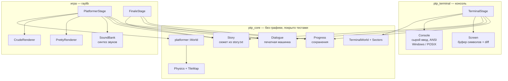

# Архитектура

## Главный принцип: логика отдельно, картинка отдельно

Каждая стадия разделена на две части:

| Логика (ничего не рисует) | Отображение (ничего не решает) |
|---|---|
| `terminal/TerminalWorld` | `terminal/TerminalStage` |
| `platformer/World` | `gfx/crude/CrudeRenderer`, `gfx/pretty/PrettyRenderer` |

Логика собрана в библиотеку `ptp_core`, которая **не зависит от raylib**. Поэтому:

- её можно тестировать без окна и видеокарты (тесты гоняются на GitHub Actions);
- стрёмное и красивое 2D — один и тот же мир, отличается только рендерер и настройки физики.



## Приёмы, которые стоит показать на защите

### 1. «Стратегия»: один мир — два рендерера

```cpp
class PlatformerRenderer {
public:
    virtual void beginLevel(const World&, const Level&) = 0;
    virtual void onEvent(const WorldEvent&, const World&) = 0;
    virtual void update(float dt, const World&) = 0;
    virtual void draw(const World&, const StageView&) = 0;
};
```

`PlatformerStage` не знает, какую графику рисует: ему подсовывают `CrudeRenderer` или `PrettyRenderer`.
Хочешь третий стиль (например, «ч/б нуар») — пишешь новый класс, остальной код не трогаешь.

### 2. События вместо прямых вызовов

`World` не вызывает звуки и эффекты, а складывает события (`Jump`, `Stomp`, `Spring`, `Shard`…).
Стадия забирает их через `drainEvents()` и раздаёт: звук — в `SoundBank`, частицы и тряску — в рендерер,
диалоги — себе. Логика не зависит от того, кто и как на неё реагирует.

Так же устроен сюжет: мир не знает ни одной реплики. Он сообщает «герой прошёл сюжетную точку №2»
(`StoryPoint`) или «встретил Алину» (`BuddyMet`), а стадия находит нужный текст в `story.txt`.

### 3. Фиксированный шаг физики

Физика всегда шагает по 1/120 секунды, независимо от FPS (`kFixedStep`). Поэтому прыжок одинаковой высоты
на слабом ноутбуке и на мощном ПК, а тесты детерминированы.

### 4. Поиск в ширину для жуков (карта расстояний)

В терминале жуки идут к герою по кратчайшему пути. Вместо поиска пути для каждого жука
делается **один** обход в ширину от героя (`rebuildDistanceField`), и каждый жук просто шагает
в соседнюю клетку с меньшим расстоянием. Работает для любого числа жуков за один проход.

### 5. Секторы терминала — это данные

Три сектора первой стадии отличаются только картой и структурой `Config` (`terminal/Sectors.cpp`):
сколько байт собрать, когда приходит Обнуление, есть ли тьма. Код мира один на всех.
Хочешь четвёртый сектор — добавляешь строку в таблицу и карту в `assets/levels`.

### 6. RAII для терминала

`Console` в конструкторе переводит терминал в «сырой» режим, в деструкторе возвращает как было.
Даже если игра бросит исключение, терминал пользователя не останется сломанным.

### 7. Экранный буфер с diff

`Screen` хранит прошлый кадр и отправляет в терминал только изменившиеся символы. Это убирает мерцание
в медленной консоли Windows.

### 8. Данные отдельно от кода

Сюжет (`story.txt`), уровни (`levels/*.txt`) и титры (`credits.txt`) — обычные текстовые файлы.
Сценарист и дизайнер уровней работают без компилятора.

Разговоры привязываются к местам на уровне прямо в файле карты: символ `!` на карте и строка
`@talk имя_секции` в шапке. Если их число не совпало, уровень не загрузится — ошибку видно сразу,
а не в середине прохождения.

### 9. Звук без файлов

`gfx/Audio.cpp` синтезирует все звуки из синусов, квадратных волн и шума.
Стрёмное 2D «пищит» как PC Speaker, красивое — звучит мягко и с эхом. Одна таблица звуков, два стиля.

## Тесты

| Файл | Что проверяет |
|---|---|
| `test_terminal_world.cpp` | биты → байты → навыки, жуки догоняют, Обнуление, рывок, тьма, все три сектора корректны |
| `test_physics.cpp` | падение, стены, потолок, шипы |
| `test_world.cpp` | бег, прыжок, двойной прыжок, «койотское время», жуки, друзья, пружины, сюжетные точки, осколки |
| `test_levels_playable.cpp` | **бот проходит все 8 уровней**, собирает все осколки, а без Алины и Егора — застревает |
| `test_tilemap.cpp` | разбор уровней, `@talk`/`@shard`, все уровни игры загружаются |
| `test_story.cpp`, `test_dialogue.cpp` | у каждого разговора на уровнях есть текст, в финале говорят все трое, печатная машинка, титры |
| `test_progress.cpp`, `test_utf8.cpp` | сохранения, аргументы, русский текст |

Бот-тестировщик (`test_levels_playable.cpp`) перебирает действия «влево / вправо / прыжок / рывок»
поиском в ширину. Если кто-то нарисует непроходимый уровень — тест упадёт сразу, а не на защите.

Тот же бот проверяет сюжет механикой: если убрать с карты Алину, стену в конце первого уровня не взять;
если убрать Егора — не перелететь провал. Друзья нужны герою не только на словах.

## Добавить новую стадию или стиль

1. Создать класс-наследник `PlatformerRenderer` в `src/gfx/<стиль>/`.
2. Добавить файлы в `CMakeLists.txt`.
3. В `main.cpp` собрать `StageSetup` (уровни, физика, звук) и вызвать `runPlatformerStage`.
