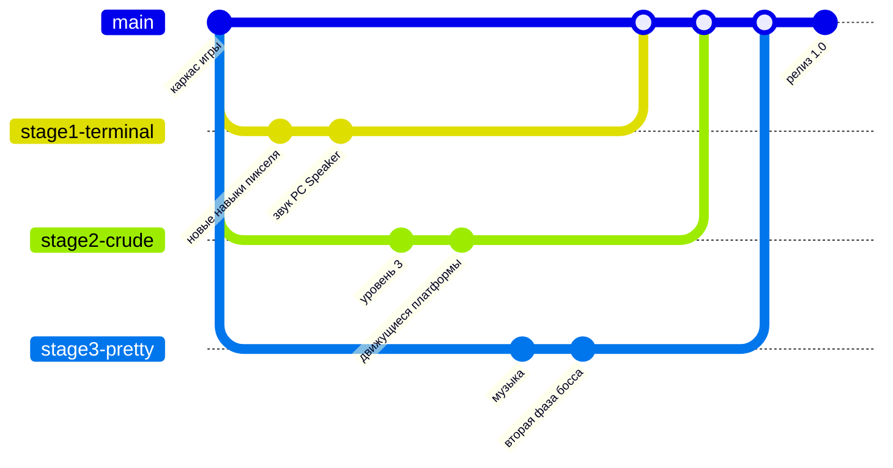

# Команда, роли и план до сдачи

Сдача — **1 декабря**. Требования преподавателя и где каждое из них закрывается:

| Требование | Где смотреть |
|---|---|
| Красивое описание | [README.md](../README.md) — скриншоты, стадии, схема архитектуры |
| 3 ветки, по одной на участника | `stage1-terminal`, `stage2-crude`, `stage3-pretty` (см. ниже) |
| История коммитов | маленькие осмысленные коммиты в своих ветках, слияние через Pull Request |
| Кто что сделал, роли | таблица ниже + `git shortlog` + вкладка Insights → Contributors на GitHub |
| Демонстрация в презентации | [PRESENTATION.md](PRESENTATION.md) — план слайдов и сценарий демо |
| Интересная игра, хороший код | 4 стадии, тесты, CI, архитектура — [ARCHITECTURE.md](ARCHITECTURE.md) |
| Открытый репозиторий | Settings → General → Danger Zone → Change visibility → Public |

## Роли

### Тимур «SaTu» — тимлид, геймдизайнер, сценарист

Ветка: **`stage1-terminal`**

Отвечает за: стадию 1 (терминал), сюжет, порядок стадий, презентацию.

Файлы: `src/terminal/`, `src/main.cpp`, `src/core/Story.*`, `assets/story.txt`, `assets/levels/terminal.txt`.

### Участник 2 — программист движка

Ветка: **`stage2-crude`**

Отвечает за: физику платформера, уровни, стадию 2 (стрёмное 2D).

Файлы: `src/platformer/`, `src/gfx/crude/`, `src/gfx/PlatformerStage.*`, `assets/levels/crude_*.txt`, тесты физики.

### Участник 3 — графика, эффекты, финал

Ветка: **`stage3-pretty`**

Отвечает за: стадию 3 (красивое 2D), босса, частицы и звук, финал, монтаж видео.

Файлы: `src/gfx/pretty/`, `src/gfx/finale/`, `src/gfx/Audio.*`, `assets/levels/pretty_*.txt`, `assets/video/`.

**Все трое** снимаются в финальном видео: Тимур — Пиксель, участник 2 — Глюк, участник 3 — Шейдер
(поменяйте как хотите в [`assets/credits.txt`](../assets/credits.txt)).

## Как устроены ветки



1. `main` — всегда рабочая версия. Напрямую в неё не коммитим.
2. Каждый работает в **своей** ветке и делает коммиты от **своего** GitHub-аккаунта.
3. Готовый кусок → Pull Request в `main` → кто-то из команды смотрит → слияние.
4. Перед PR подтяните свежий `main`, чтобы не было конфликтов: `git pull origin main`.

Создать свою ветку (один раз):

```bash
git checkout main
```

```bash
git pull
```

```bash
git checkout -b stage2-crude
```

```bash
git push -u origin stage2-crude
```

### Коммиты

Пишите по-русски, в повелительном наклонении и по делу — так история читается как дневник проекта:

```
Добавить движущиеся платформы в стрёмное 2D
Исправить застревание жука в углу
Ускорить сборщика мусора после второго байта
```

Плохо: `fix`, `asdasd`, `всё сделал`. Лучше 10 маленьких коммитов, чем один огромный в последний день.

### Как показать «кто что сделал»

```bash
git shortlog -sn --all
```

```bash
git log --author="SaTu" --oneline
```

На GitHub: **Insights → Contributors** (графики по каждому участнику) и **Insights → Network** (дерево веток).

## План до 1 декабря

Каркас игры уже играется от начала до конца: все 4 стадии, 6 уровней, босс, сюжет, титры, тесты и CI.
Дальше — делаем её своей и интересной.

### Неделя 1 (10–16 ноября) — освоиться и расшириться

- [ ] **Все:** собрать проект у себя, пройти игру целиком, создать свою ветку
- [ ] **Все:** вписать свои имена в `assets/credits.txt`
- [ ] **Тимур:** переписать сюжет под себя (`assets/story.txt`) — шутки, мемы, внутренние приколы
- [ ] **Тимур:** новый тип врага в терминале (например, «вирус», который размножается)
- [ ] **Участник 2:** уровень 3 для стрёмного 2D
- [ ] **Участник 3:** музыка для красивого 2D (raylib умеет `LoadMusicStream`, файл в `assets/`)

### Неделя 2 (17–23 ноября) — фичи и видео

- [ ] **Тимур:** звук в терминале (пищалка `\a` или ASCII-«анимации»), счётчик рекорда
- [ ] **Участник 2:** движущиеся платформы или пружины в `platformer/World` + тесты на них
- [ ] **Участник 3:** вторая фаза босса (после 2 ударов — новая атака)
- [ ] **Все:** снять финальное видео (сценарий — [assets/video/README.md](../assets/video/README.md))

### Неделя 3 (24–30 ноября) — полировка и сдача

- [ ] **Все:** дать поиграть друзьям, починить то, на чём они застряли
- [ ] **Участник 3:** смонтировать видео, положить `assets/video/finale.mp4`
- [ ] **Тимур:** слить ветки в `main`, проверить, что CI зелёный, сделать релиз (Releases → Draft new release)
- [ ] **Все:** презентация по [PRESENTATION.md](PRESENTATION.md), прогон демо
- [ ] Репозиторий — **Public**

## Идеи, если останется время

- Таблица рекордов: время прохождения и смерти.
- Секретная стадия «3D» в финальных титрах (шутка над «3Д это сложно»).
- Достижения: «Не умер ни разу», «Собрал все пиксели», «Постоял под сборщиком мусора».
- Пасхалки: Глюк иногда ломает интерфейс по-настоящему.

## Про стартовый каркас

Стартовый каркас (движок стадий, уровни, тесты, CI и документация) сделан с помощью ИИ-ассистента
Claude Code — это видно по автору первых коммитов. Всё, что делает команда дальше, — в ветках участников
под их собственными именами. На защите стоит честно сказать об этом и показать, что вы добавили и поменяли сами.
