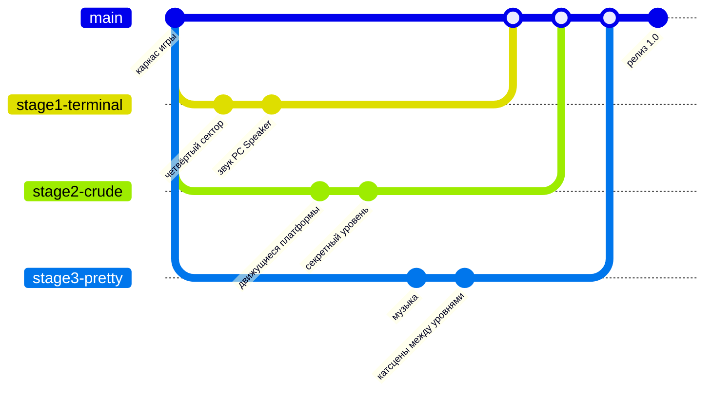

# Команда, роли и план до сдачи

Сдача — **1 декабря**. Требования преподавателя и где каждое из них закрывается:

| Требование | Где смотреть |
|---|---|
| Красивое описание | [README.md](../README.md) — скриншоты, стадии, схема архитектуры |
| 3 ветки, по одной на участника | `stage1-terminal`, `stage2-crude`, `stage3-pretty` (см. ниже) |
| История коммитов | маленькие осмысленные коммиты в своих ветках, слияние через Pull Request |
| Кто что сделал, роли | таблица ниже + `git shortlog` + вкладка Insights → Contributors на GitHub |
| Демонстрация в презентации | [PRESENTATION.md](PRESENTATION.md) — план слайдов и сценарий демо |
| Интересная игра, хороший код | сюжет на полчаса ([STORY.md](STORY.md)), 4 стадии, тесты, CI, архитектура — [ARCHITECTURE.md](ARCHITECTURE.md) |
| Открытый репозиторий | Settings → General → Danger Zone → Change visibility → Public |

## Роли

### Тимур «SaTu» — тимлид, геймдизайнер, сценарист

Ветка: **`stage1-terminal`**

Отвечает за: стадию 1 (терминал), сюжет, порядок стадий, презентацию.

Файлы: `src/terminal/`, `src/main.cpp`, `src/core/Story.*`, `assets/story.txt`, `assets/levels/terminal_*.txt`.

### Участник 2 — программист движка

Ветка: **`stage2-crude`**

Отвечает за: физику платформера, уровни, стадию 2 (стрёмное 2D).

Файлы: `src/platformer/`, `src/gfx/crude/`, `src/gfx/PlatformerStage.*`, `assets/levels/crude_*.txt`, тесты физики.

### Участник 3 — графика, эффекты, финал

Ветка: **`stage3-pretty`**

Отвечает за: стадию 3 (красивое 2D), частицы и звук, финал, монтаж видео.

Файлы: `src/gfx/pretty/`, `src/gfx/finale/`, `src/gfx/Audio.*`, `assets/levels/pretty_*.txt`, `assets/video/`.

**Все трое** снимаются в финальном видео в ролях Тимура, Алины и Егора — сценарий лежит
в [`assets/video/final_cutscene.txt`](../assets/video/final_cutscene.txt). Кто кого играет, впишите
в [`assets/credits.txt`](../assets/credits.txt) (сейчас там стоит «впишите имя»).

## Как устроены ветки



1. `main` — всегда рабочая версия. Напрямую в неё не коммитим.
2. Каждый работает в **своей** ветке и делает коммиты от **своего** GitHub-аккаунта.
3. Готовый кусок → Pull Request в `main` → кто-то из команды смотрит → слияние.
4. Перед PR подтяните свежий `main`, чтобы не было конфликтов: `git pull origin main`.

Создать свою ветку (один раз):

```bash
git checkout main
```

```bash
git pull
```

```bash
git checkout -b stage2-crude
```

```bash
git push -u origin stage2-crude
```

### Коммиты

Пишите по-русски, в повелительном наклонении и по делу — так история читается как дневник проекта:

```
Добавить движущиеся платформы в стрёмное 2D
Исправить застревание жука в углу
Ускорить Обнуление в третьем секторе
```

Плохо: `fix`, `asdasd`, `всё сделал`. Лучше 10 маленьких коммитов, чем один огромный в последний день.

### Как показать «кто что сделал»

```bash
git shortlog -sn --all
```

```bash
git log --author="SaTu" --oneline
```

На GitHub: **Insights → Contributors** (графики по каждому участнику) и **Insights → Network** (дерево веток).

## План до 1 декабря

Каркас игры уже проходится от начала до конца примерно за полчаса: 3 сектора терминала, 8 уровней
платформера, сюжет с Тимуром, Алиной и Егором, текстовый финал, титры, тесты и CI.
Дальше — делаем её своей.

### Неделя 1 (до 16 ноября) — освоиться

- [ ] **Все:** собрать проект у себя, пройти игру целиком, создать свою ветку
- [ ] **Все:** вписать свои имена в `assets/credits.txt` и в таблицу в README
- [ ] **Все:** прочитать [STORY.md](STORY.md) и сценарий финала, договориться, кто кого играет
- [ ] **Тимур:** пройтись по `assets/story.txt` и переписать реплики своими словами — шутки, мемы, свои словечки
- [ ] **Участник 2:** поправить места в уровнях, где застреваешь сам (`assets/levels/crude_*.txt`)
- [ ] **Участник 3:** музыка для красивого 2D (raylib умеет `LoadMusicStream`, файл в `assets/`)

### Неделя 2 (17–23 ноября) — фичи и видео

- [ ] **Тимур:** четвёртый сектор терминала или новый враг (например, «вирус», который размножается)
- [ ] **Участник 2:** движущиеся платформы в `platformer/World` + тест на них
- [ ] **Участник 3:** эффект перехода между уровнями, анимация встречи с Алиной и Егором
- [ ] **Все:** снять финальное видео по [сценарию](../assets/video/final_cutscene.txt)

### Неделя 3 (24–30 ноября) — полировка и сдача

- [ ] **Все:** дать поиграть друзьям, засечь время, починить то, на чём они застряли
- [ ] **Участник 3:** смонтировать видео, положить `assets/video/finale.mp4`
- [ ] **Тимур:** слить ветки в `main`, проверить, что CI зелёный, сделать релиз (Releases → Draft new release)
- [ ] **Все:** презентация по [PRESENTATION.md](PRESENTATION.md), прогон демо
- [ ] Репозиторий — **Public**

## Идеи, если останется время

- Таблица рекордов: время прохождения и смерти.
- Достижения: «Не умер ни разу», «Нашёл все осколки памяти», «Постоял под Обнулением и выжил».
- Вторая концовка: если собрать все семь осколков, в титрах появляется ответ Другого Тимура.
- Секретная стадия «3D» в титрах (шутка над «3Д это сложно»).

## Про стартовый каркас

Стартовый каркас (движок стадий, уровни, тесты, CI и документация) сделан с помощью ИИ-ассистента
Claude Code — это видно по автору первых коммитов. Всё, что делает команда дальше, — в ветках участников
под их собственными именами. На защите стоит честно сказать об этом и показать, что вы добавили и поменяли сами.
